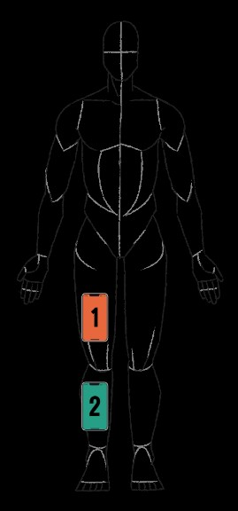
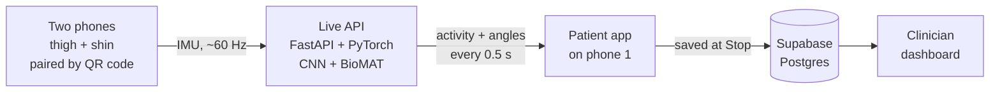
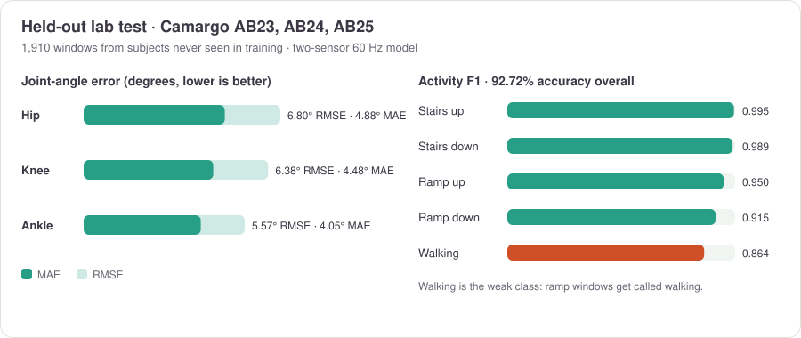
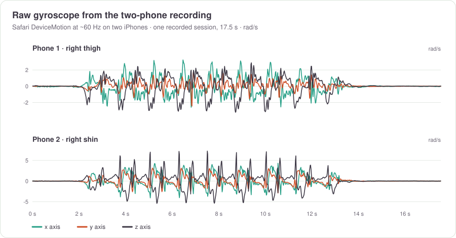
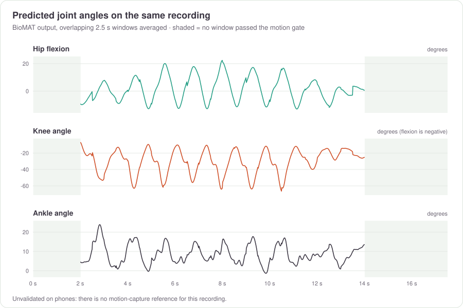

<div align="center">

# I'M YOU

**Joint-angle tracking for rehab, from two phones the patient already owns.**

Built at **natHacks 2026** by the Movement Tracking Team.


</div>

---

Joint angles are usually measured in a lab or clinic, so between visits a clinician has little objective data on how a patient is doing. **I'M YOU moves that measurement home.** The patient straps two phones to their leg, walks, and a transformer model turns the phones' motion sensors into hip, knee and ankle angles that land on the clinician's dashboard.

> [!IMPORTANT]
> Hackathon prototype. Phone joint angles have never been compared against motion capture, so nothing here is a clinical measurement, a diagnosis, or a pass/fail rehab result.

## How it works



1. **Clinician adds the patient** and hands over a username and password.
2. **Patient signs in on phone 1** and picks a movement (walking or stairs).
3. **Phone 2 scans a QR code.** No account needed; the two phones pair over Supabase Realtime.
4. **Strap them on:** phone 1 on the outer right thigh, phone 2 on the right shin.
5. **Tap Start.** Both phones stream accelerometer and gyroscope data from Safari at about 60 Hz to the live model.
6. **Every 0.5 s the model returns** the activity and the last 2.5 s of hip, knee and ankle angle.
7. **Tap Stop.** The session summary and the model's angle curves are saved for the clinician.

Prefer one phone? The **camera method** runs Google MediaPipe pose detection on the device for walking, running, stairs and sit-to-stand. Video never leaves the phone.

<br clear="right">



Raw sensor samples go only to the model and are never stored. Supabase keeps scores and angle curves, nothing that could rebuild a video or a body.

## The model

Two networks look at the same 2.5 s window from the thigh and shin sensors: **MovementCNN** names the activity and **[BioMAT](https://github.com/MohsenSharifi1991/BioMAT)**, a transformer, predicts the joint-angle curves. Both were trained from scratch on lab data only; phone recordings were used to check the model, never to train it.

| | |
| --- | --- |
| **Training data** | [Camargo et al.](https://www.epic.gatech.edu/opensource-biomechanics-camargo-et-al/) lab IMU + motion capture. 16 participants for development (AB06–AB21), 3 held out for testing (AB23–AB25). |
| **Sensors used** | Right thigh + right shank only, accelerometer and gyroscope (12 channels) |
| **Window** | 2.5 s, 20 Hz low-pass, rotated into a frame derived from the signal so phone mounting doesn't matter |
| **Activity model** | MovementCNN, 3 conv blocks, 5 classes, 30 epochs, AdamW |
| **Angle model** | BioMAT: 4 encoder layers, 16 heads, embedding 256, dropout 0.5, Adam |
| **Validation** | 5 subject folds (no person in both train and validation), early stopping; final model trained for 21 epochs, then scored once on the held-out subjects |
| **Serving** | 100 Hz version behind FastAPI; 26 ms median inference on CPU |

### Results



On the team's own 8 labelled phone trials, the activity matched the label in **91.8%** of windows once ramp classes were left out (nobody walked a ramp). The motion gate held back **54%** of windows as too still to score.

### From the phones

One real session from our two iPhones, and what the model made of it:





Training, the phone receiver and the live API live in **[Movement-Tracking-Machine-Learning](https://github.com/Movement-Tracking-Team/Movement-Tracking-Machine-Learning)**.

## Tech stack

| Part | Tools |
| --- | --- |
| App | TypeScript (strict), React Native, Expo Router: one codebase for iOS, Android and web |
| Backend | Supabase: Auth, Postgres with row-level security, Realtime, Edge Functions |
| Sensors | Safari DeviceMotion (phones), MediaPipe Pose Landmarker (camera) |
| Model | Python 3.11, PyTorch, NumPy, SciPy, scikit-learn |
| Live API | FastAPI, Uvicorn, WebSockets; runs on a team machine reached over Tailscale |
| Hosting | Vercel (web app) |

## Repo layout

```
frontend/
  app/            screens: (auth), (patient) home/track/results, (clinician) dashboard, pair/[code]
  src/features/   auth, capture/cv (camera), capture/imu (phone sensors), care, results
  src/lib/        Supabase client, theme, formatting
supabase/
  migrations/     schema and row-level security
  functions/      create-account Edge Function
```

## Run it locally

```sh
cd frontend
cp .env.example .env     # Supabase URL + publishable key, live API URL
npm install
npx expo start --web
```

Phone-sensor sessions also need the live API from the ML repo (`python live-api/server.py`), reachable from the phones over `wss://`. Full setup in [`frontend/README.md`](frontend/README.md).

## Limits

- **No phone ground truth.** Lab error is 5.6–6.8°; error on phones is unmeasured.
- **Walking and stairs only** for phone sensors. Running and sit-to-stand use the camera.
- **One 2.5 s window** of angles is saved per session, the one the model was surest about.
- **Two phones on one leg** (right side). The model was never trained on the left leg.

## Credits

- **Dataset:** Camargo et al., [open-source lower-limb biomechanics dataset](https://www.epic.gatech.edu/opensource-biomechanics-camargo-et-al/), Georgia Tech EPIC Lab
- **Model:** [BioMAT](https://github.com/MohsenSharifi1991/BioMAT) and the [*Sensors* paper](https://www.mdpi.com/1424-8220/23/13/5778) behind it
- **Exercise clips:** CDC STEADI demonstrations (public domain) and Pexels contributors, credited in the app
